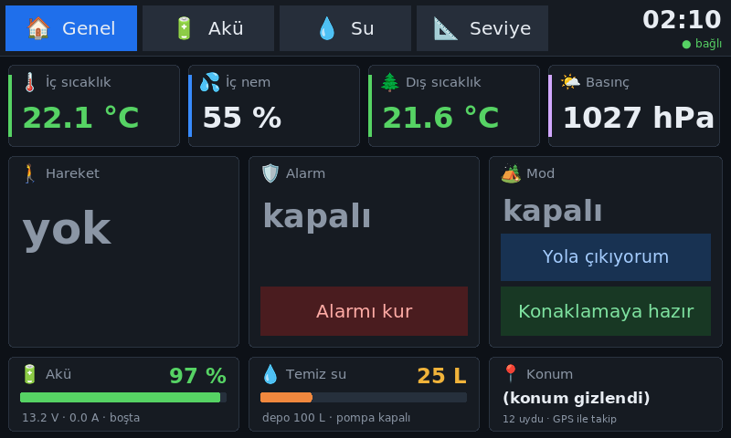

# Caravan Automation

*[Türkçe](README.md)*

📄 Short overview in Turkish (2 pages, with screenshots): [Akilli_Karavan.pdf](tasarim/tanitim/Akilli_Karavan.pdf)

A home-made smart system for a towed caravan: an ESP32 sensor node (ESPHome) plus a touchscreen panel connected over MQTT.
The panel runs on a small Linux mini PC inside the caravan, gives spoken warnings in Turkish, and sends phone notifications (ntfy) for important events.

## Features

- **Motion alarm**: PIR sensor; when armed, a siren on the panel plus a phone notification
- **GPS alarm**: if the caravan moves while the alarm is armed, a notification with a map link
- **Levelling**: MPU6050 tilt sensor; spoken guidance such as "lower the rear-left leg, about 3 cm"
- **Camping mode**: if the caravan shifts, a calm spoken warning inside
- **Battery**: voltage, current, state of charge and cells from a Daly-compatible LiFePO4 BMS over Bluetooth
- **Fresh water**: flow sensor at the pump outlet plus a contactless level sensor on the tank; calculates litres left and recalibrates itself
- **Climate**: indoor temperature/humidity/pressure (BME280), outdoor temperature (DS18B20)

## Files

| File / folder | Purpose |
|---|---|
| `sensor-dugumu.yaml` | ESP32 firmware (ESPHome) |
| `karavan.h` | Tilt and distance calculations |
| `secrets.ornek.yaml` | Example secrets file → copy to `secrets.yaml` and fill in |
| `panel/` | Browser panel (MQTT.js) and Turkish voice files |
| `yerel_panel/panel.py` | Lightweight panel for slow computers (Python + Tk) |
| `mini_pc/` | Mini PC kiosk setup |
| `semalar/` | Wiring diagrams |
| `YAPILACAKLAR.md` | To-do and shopping list (Turkish) |

## Hardware

ESP32 (esp32dev), MPU6050, BME280, DS18B20, HC-SR501 PIR, YF-S201 flow sensor, XKC-Y25-V level sensor,
NEO-M8N GPS, relay board, 12 V 200 Ah LiFePO4 battery (Bluetooth BMS).

## Setup

1. Copy `secrets.ornek.yaml` to `secrets.yaml` and enter your own WiFi and ntfy details.
2. Build and flash with ESPHome: `esphome run sensor-dugumu.yaml`
3. Install an MQTT broker (Mosquitto with websocket port 9001 open); point the panel at it with `?broker=ADDRESS`.

The code, comments and user interface are in Turkish.
Voice prompts were generated with [Chatterbox Multilingual](https://github.com/resemble-ai/chatterbox) (ResembleAI, MIT). A Turkish female speaker recording from [Google FLEURS](https://huggingface.co/datasets/google/fleurs) (CC-BY 4.0) was used as the voice reference. Generation scripts: `tasarim/ses_uretim/`.
