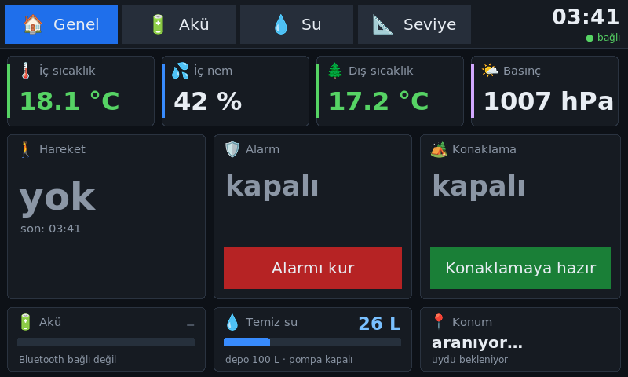

# Karavan Otomasyonu

*[English](README.en.md)*

Çekme karavan için ev yapımı akıllı sistem: ESP32 sensör düğümü (ESPHome) + MQTT ile çalışan dokunmatik panel.
Panel karavandaki küçük bir Linux mini PC'de çalışıyor, uyarıları Türkçe sesli veriyor, önemli olaylarda telefona (ntfy) bildirim gönderiyor.

## Neler yapıyor

- **Hareket alarmı**: PIR sensörü; alarm kurulunca panelde siren + telefona bildirim
- **GPS alarmı**: alarm kuruluyken karavan yer değiştirirse konum linkiyle bildirim
- **Seviye ayarı**: MPU6050 eğim sensörü; "sol arka ayağı indir, yaklaşık 3 santim" gibi sesli yönlendirme
- **Konaklama modu**: karavan kayarsa içeride sakin bir sesli uyarı
- **Akü**: Daly uyumlu LiFePO4 BMS'ten Bluetooth ile voltaj, akım, doluluk, hücreler
- **Temiz su**: pompa çıkışında akış sensörü + depo dışında temassız seviye sensörü ile litre hesabı, kendini kalibre eder
- **İklim**: iç sıcaklık/nem/basınç (BME280), dış sıcaklık (DS18B20)

## Dosyalar

| Dosya / klasör | Ne işe yarıyor |
|---|---|
| `sensor-dugumu.yaml` | ESP32 yazılımı (ESPHome) |
| `karavan.h` | Eğim ve mesafe hesapları |
| `secrets.ornek.yaml` | Şifre dosyası örneği → `secrets.yaml` adıyla kopyalayıp doldurun |
| `panel/` | Tarayıcı paneli (MQTT.js) ve Türkçe ses dosyaları |
| `yerel_panel/panel.py` | Zayıf bilgisayarlar için hafif panel (Python + Tk) |
| `mini_pc/` | Mini PC kiosk kurulumu |
| `semalar/` | Bağlantı şemaları |
| `YAPILACAKLAR.md` | Yapılacaklar ve alışveriş listesi |

## Donanım

ESP32 (esp32dev), MPU6050, BME280, DS18B20, HC-SR501 PIR, YF-S201 akış sensörü, XKC-Y25-V seviye sensörü,
NEO-M8N GPS, röle kartı, 12 V 200 Ah LiFePO4 akü (Bluetooth BMS).

## Kurulum

1. `secrets.ornek.yaml` dosyasını `secrets.yaml` adıyla kopyalayıp kendi WiFi ve ntfy bilgilerinizi yazın.
2. ESPHome ile derleyip yükleyin: `esphome run sensor-dugumu.yaml`
3. MQTT broker (Mosquitto, websocket portu 9001 açık) kurun; panelde broker adresini `?broker=ADRES` ile verin.

Sesler [Chatterbox Multilingual](https://github.com/resemble-ai/chatterbox) (ResembleAI, MIT) ile üretildi. Ses rengi için referans olarak [Google FLEURS](https://huggingface.co/datasets/google/fleurs) veri setinden (CC-BY 4.0) bir Türkçe kadın konuşmacı kaydı kullanıldı. Üretim betikleri: `tasarim/ses_uretim/`.
